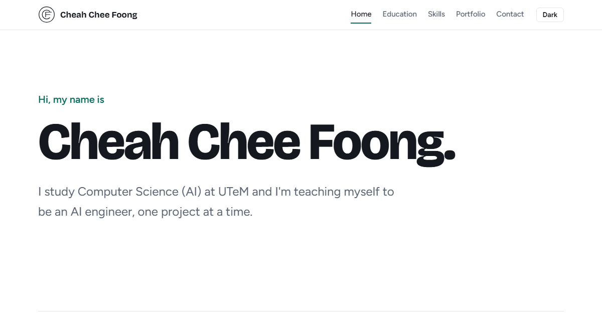

# Personal Site


My personal site and portfolio. I study Computer Science (AI) at UTeM and I'm working towards being an AI engineer.

**Live site:** https://cheah20.github.io/CCF_PersonalSite/



## Pages

| Page | What is on it |
|---|---|
| Home | Short intro, about me and three selected projects |
| Education | Degree, internship, diploma and certificates |
| Skills | AI engineering skills I use or am learning, and my 90-day learning plan |
| Portfolio | Every project with its course, what I did, screenshots and links |
| Contact | Email, GitHub and LinkedIn |

## Built With

- Plain HTML, CSS and JavaScript, no framework or build step
- Google Fonts: Bricolage Grotesque and Figtree
- Hosted on GitHub Pages

The pages switch on the URL hash (`#home`, `#portfolio` and so on), so links to a page can be shared. Light mode is the default, and the theme button switches to dark.

## Run Locally

```bash
python -m http.server 5500
```

Then open http://localhost:5500.

## Project Structure

```text
CCF_PersonalSite/
├── index.html      # all five pages
├── css/style.css
├── js/main.js      # page switch, theme, filter, card tilt, image viewer
└── img/            # logo, covers and project screenshots
```
